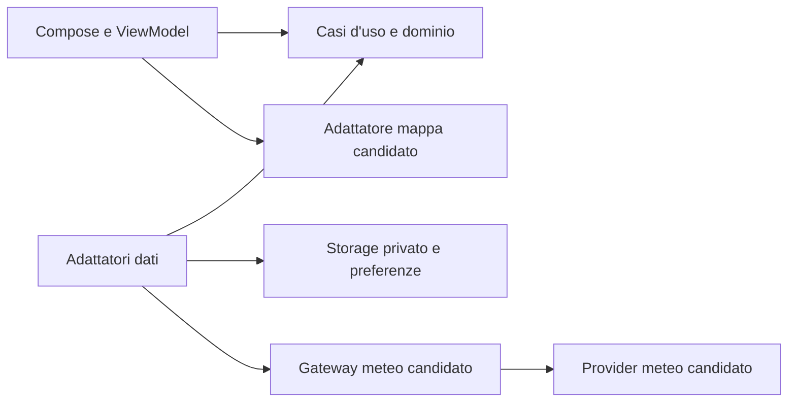
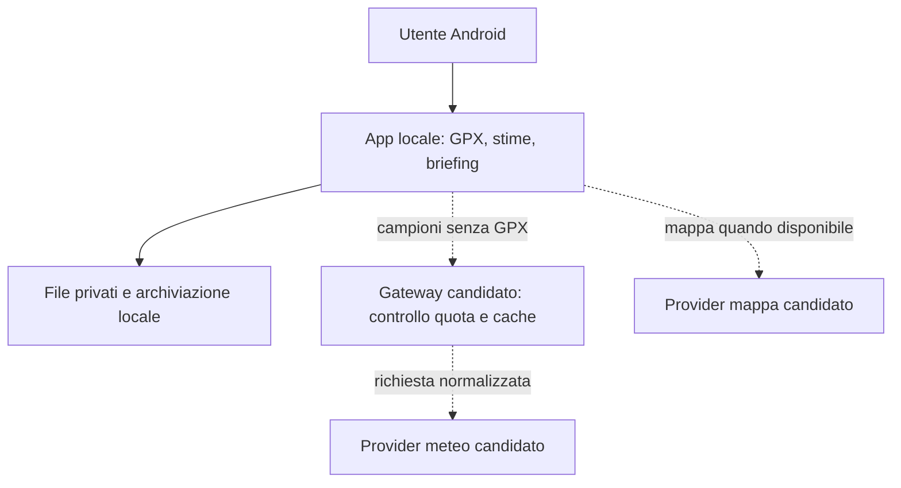

# Architecture Spine — TrekCheck MVP Free

## Paradigma

Architettura a livelli con porte e adattatori, local-first. Compose presenta stato immutabile tramite ViewModel; casi d'uso e dominio dipendono da interfacce; gli adattatori implementano persistenza, importazione, rete e mappe. Il seed attuale è il singolo modulo Gradle `:app`; i livelli sono confini logici, non richiedono nuovi moduli.

## Invarianti e regole

### AD-1 — Dipendenze e stato [ADOPTED]

- **Binds:** tutte le feature Android.
- **Prevents:** accesso diretto UI a storage, SDK e DTO del provider, dipendenza del core dal Premium.
- **Rule:** la UI invia eventi ai ViewModel e osserva stato immutabile; mutazioni tramite casi d'uso e repository. Il dominio definisce porte e modelli propri, senza dipendenze UI, DTO del fornitore o feature Premium. Mappa è adattatore di presentazione; Premium può dipendere dal core ma mai viceversa.

### AD-2 — Confine dei dati e geometria [ADOPTED]

- **Binds:** FR-1–FR-5, FR-14–FR-15, NFR-1–NFR-2.
- **Prevents:** fuga del GPX completo, perdita dei segmenti, migliaia di righe DB per punto.
- **Rule:** GPX completo e geometria risiedono in file privati versionati; la geometria normalizzata preserva segmenti, coordinate e quota opzionale; metadati e riferimenti persistono localmente. Vietata una entità Room per ogni TrackPoint. Le metriche usano geometria completa; la versione semplificata serve solo al rendering. Il parser rifiuta XML non sicuro, DTD remoti ed entità esterne.

### AD-3 — Tempo e modelli di dominio [ADOPTED]

- **Binds:** FR-4–FR-9, FR-11, NFR-6.
- **Prevents:** ETA discordanti e timestamp locali scambiati per assoluti.
- **Rule:** piani memorizzano `departureInstant` e `ZoneId` del percorso; punti di timing hanno distanza cumulativa e ETA come `Instant`. Formattazione nella zona del percorso alla UI. DST ambiguo o inesistente richiede risoluzione esplicita. I modelli del dominio usano unità canoniche SI e nullabilità esplicita, senza zeri sostitutivi per dati mancanti.

### AD-4 — Previsioni e confine gateway [ADOPTED]

- **Binds:** FR-6–FR-8, FR-16, NFR-1–NFR-3.
- **Prevents:** diffusione DTO proprietari, dati identificativi al fornitore, cache errate e chiamate fuori orizzonte.
- **Rule:** un'unica porta `WeatherProvider` riceve al massimo 12 campioni con ID, coordinate, quota opzionale ed ETA UTC; non riceve nome percorso, identità o GPX intero. Gateway valida payload e restituisce DTO UTC normalizzato con ID, validità, periodo, risoluzione, fonte e freschezza; dominio non legge schema raw provider. Cache raw normalizza coordinate e quota prima della chiave e dell'upstream e non include ETA; la corrispondenza temporale è separata. Fuori orizzonte non inviare chiamate meteo. Intervalli di precipitazione sono confrontabili solo se equivalenti; valore istantaneo fuori tolleranza è assente. Parametri e criterio dati parziali restano bloccanti in Deferred.

### AD-5 — Proprietà del briefing e quota [ADOPTED]

- **Binds:** FR-14–FR-17, NFR-2.
- **Prevents:** consumo quota su errore, doppio addebito logico e perdita del briefing valido.
- **Rule:** un solo coordinatore di generazione serializza le operazioni meteo per installazione; il contatore Free monotono vive in DataStore e non dipende dal numero di briefing. Usare ID di operazione stabile e protocollo persistente idempotente di completamento/recupero fra storage briefing e DataStore: al riavvio ogni operazione riuscita viene conteggiata esattamente una volta, nessun risultato non salvato consuma quota. Finché una operazione è incompleta, riconciliare prima di autorizzare un'altra generazione. Il puntatore allo snapshot corrente cambia solo con snapshot e briefing salvati; il fallimento conserva il precedente. Se piano, partenza, fuso o profilo cambiano durante il recupero, scartare la risposta obsoleta senza consumare quota. Il protocollo concreto e il confine di successo parziale devono essere specificati e testati prima dell'implementazione meteo.

### AD-6 — Condizioni, checklist e condivisione [ADOPTED]

- **Binds:** FR-9–FR-13, FR-18, FR-21.
- **Prevents:** motori divergenti, affermazioni di sicurezza e fughe dati nell'export.
- **Rule:** luce, regole e checklist sono calcoli locali deterministici e versionati; i risultati distinguono assente, parziale e presente e non prescrivono decisioni sanitarie o sicurezza. Share Card deriva dal briefing, è generata localmente; coordinate precise, GPX, contatti e note sono esclusi di default. Testo, anteprima e immagine rispettano stesse impostazioni e attribuzioni applicabili.

### AD-7 — Operatività a costo zero [ADOPTED]

- **Binds:** tutte le dipendenze esterne e ambienti.
- **Prevents:** addebiti non autorizzati e blocco del percorso locale per indisponibilità servizi.
- **Rule:** nessun servizio, piano, attivazione o funzione che possa comportare una spesa è abilitato senza controllo preventivo che garantisca arresto prima di un addebito; un servizio privo di tale garanzia non viene attivato. Non attivare billing o upgrade automatici. MET Norway, gateway e OpenFreeMap sono candidati e non vanno resi operativi finché non sono verificate condizioni, licenza, attribuzione e costi attuali. Se la verifica, rete o quota operativa falliscono, nessuna chiamata esterna e modalità locale route-only con spiegazione. La cache non implica gratuità illimitata. Nessuna credenziale o percorso di sessione nel repository.

## Convenzioni di coerenza

| Tema | Regola |
| --- | --- |
| ID | Identificativi opachi stabili per percorso, piano, campione, briefing, snapshot e operazione; un campione conserva il proprio ID attraverso richiesta/risposta. |
| Errori | Repository espongono errori tipizzati: non disponibile, fuori orizzonte, quota esaurita, dati parziali o non confrontabili; UI li traduce senza cancellare dati salvati. |
| Dati | Coordinate WGS84, distanza metri, quota metri opzionale, temperatura °C, vento m/s, precipitazione mm con intervallo, tempi UTC ISO-8601 sul wire; fuso IANA solo nel client. |
| Offline | Repository locale è fonte di verità dei briefing salvati; mappe e previsioni non salvate sono dichiarate indisponibili. |
| Privacy | Log e diagnostica applicativi escludono GPX, coordinate, nomi di percorso, contatti e identità; cancellazione rimuove file e riferimenti del percorso. Le richieste rete possono rivelare IP e area della mappa ai fornitori: verificare termini, minimizzazione e informativa prima dell'attivazione; definire esplicitamente la policy di backup Android e provarla prima del rilascio. |

## Stack osservato nel progetto

| Nome | Versione |
| --- | --- |
| Kotlin Gradle Plugin | 2.2.20 |
| Android Gradle Plugin | 8.13.2 |
| Gradle Wrapper | 8.14.8 |
| Jetpack Compose BOM | 2025.10.00 |
| Android compile/target | 37 |
| Android minSdk attuale | 24 |

Il PRD richiede minSdk 26, ancora da implementare. AGP 8.13.2 ha segnalato supporto testato fino a API 36.1 nella build locale; verificare la compatibilità prima di aggiornare toolchain. Room, DataStore, mappe, client HTTP e gateway sono proposte della baseline, non implementazioni né versioni verificate nel codice.

## Seed operativo

Ambienti previsti: sviluppo locale con fixture e provider simulato; CI GitHub esistente; eventuale gateway pubblico separato e disabilitato fino alla verifica di termini e costo zero. Nessun deploy è incluso. In assenza di un gateway gratuito verificato, lo sviluppo procede con dati simulati e l'app resta route-only.

## Mappa capacità → confini

| Area | Responsabilità | Regole |
| --- | --- | --- |
| FR-1–FR-5 | Import, geometria, piano, ETA | AD-1–AD-3 |
| FR-6–FR-8 | Campionamento, gateway e previsione | AD-3–AD-4, AD-7 |
| FR-9–FR-13 | Luce, briefing e regole | AD-1, AD-3, AD-6 |
| FR-14–FR-17 | Storage, offline, refresh e quota | AD-2, AD-4–AD-5, AD-7 |
| FR-18–FR-21 | Share, impostazioni, errori e limiti | AD-1, AD-6–AD-7 |

## Deferred e blocchi

1. Prima dell'implementazione meteo: definire il contratto di errore e successo per ogni campione, il criterio misurabile per risposta parziale riuscita, intervalli e tolleranza matching; definire protocollo idempotente DataStore/storage e provarlo con crash, retry e richieste concorrenti.
2. Prima di rete reale/deploy: verificare condizioni e attribuzioni dei candidati, modello di spesa zero con arresto rigido, configurazione User-Agent e limiti provider; se non verificabili, solo fixture e route-only.
3. Prima del rilascio: strategia supporto e privacy gratuita, termini e responsabilità, formato e recupero cancellazione dei dati, accessibilità, prestazioni e distribuzione senza spese. Nessun account Play a pagamento autorizzato.
4. Prima di fissare librerie o toolchain nuove: verificare compatibilità e versioni correnti, in particolare API 37 con AGP; l'architettura non prescrive versioni di dipendenze non ancora installate.
5. Validare ETA, parametri campionamento e soglie deterministiche con fixture reali; decidere UX e rendering assieme alla specifica UX, che prevale per i dettagli di presentazione senza cambiare gli invarianti qui definiti.
