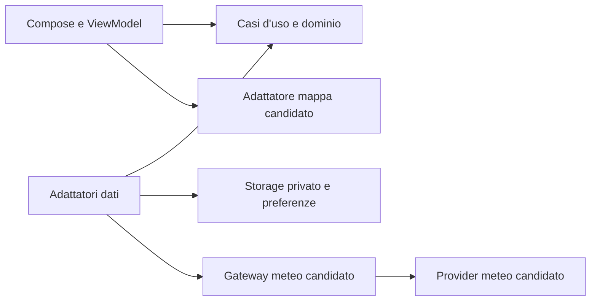
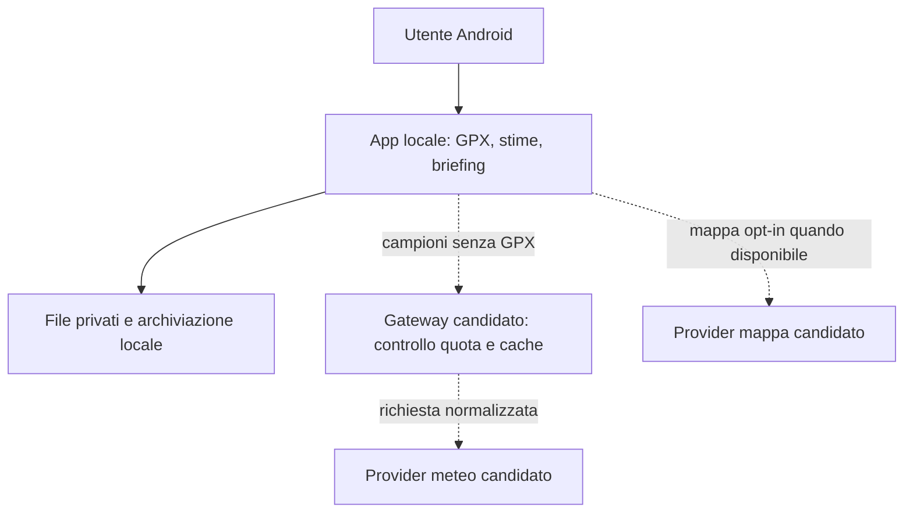

# Architecture Spine — TrekCheck MVP Free

## Paradigma

Architettura a livelli con porte e adattatori, local-first. Compose presenta stato immutabile tramite ViewModel; casi d'uso e dominio dipendono da interfacce; gli adattatori implementano persistenza, importazione, rete e mappe. Il seed attuale è il singolo modulo Gradle `:app`; i livelli sono confini logici, non richiedono nuovi moduli.

## Invarianti e regole

### AD-1 — Dipendenze e stato [ADOPTED]

- **Binds:** tutte le feature Android.
- **Prevents:** accesso diretto UI a storage, SDK e DTO del provider, dipendenza del core dal Premium.
- **Rule:** la UI invia eventi ai ViewModel e osserva stato immutabile; mutazioni tramite casi d'uso e repository. Il dominio definisce porte e modelli propri, senza dipendenze UI, DTO del fornitore o feature Premium. Mappa è adattatore di presentazione; Premium può dipendere dal core ma mai viceversa.

### AD-2 — Confine dei dati e geometria [ADOPTED]

- **Binds:** FR-1–FR-5, FR-14–FR-15, NFR-1–NFR-2.
- **Prevents:** fuga del GPX completo, perdita dei segmenti, migliaia di righe DB per punto.
- **Rule:** GPX completo e geometria risiedono in file privati versionati; la geometria normalizzata preserva segmenti, coordinate e quota opzionale; metadati e riferimenti persistono localmente. Vietata una entità Room per ogni TrackPoint. Le metriche usano geometria completa; la versione semplificata serve solo al rendering. Il parser rifiuta XML non sicuro, DTD remoti ed entità esterne.

### AD-3 — Tempo e modelli di dominio [ADOPTED]

- **Binds:** FR-4–FR-9, FR-11, NFR-6.
- **Prevents:** ETA discordanti e timestamp locali scambiati per assoluti.
- **Rule:** piani memorizzano `departureInstant` e `ZoneId` del percorso; punti di timing hanno distanza cumulativa e ETA come `Instant`. Formattazione nella zona del percorso alla UI. DST ambiguo o inesistente richiede risoluzione esplicita. I modelli del dominio usano unità canoniche SI e nullabilità esplicita, senza zeri sostitutivi per dati mancanti.

### AD-4 — Previsioni e confine gateway [ADOPTED]

- **Binds:** FR-6–FR-8, FR-16, NFR-1–NFR-3.
- **Prevents:** diffusione DTO proprietari, dati identificativi al fornitore, cache errate e chiamate fuori orizzonte.
- **Rule:** un'unica porta `WeatherProvider` riceve al massimo 12 campioni con ID, coordinate, quota opzionale ed ETA UTC; non riceve nome percorso, identità o GPX intero. Gateway valida payload e restituisce un contratto tipizzato `WeatherBatchResult` (`Success` con mappa per-`SampleId` di `SampleWeatherStatus.Available` / `Unavailable(reason)` + `fetchedAtUtc` e `sourceAttribution`, oppure `GlobalFailure`: `Offline`, `OutOfHorizon`, `RateLimited`, `ProviderUnavailable`); il dominio non legge schema raw provider. Cache raw normalizza coordinate e quota prima della chiave e dell'upstream e non include ETA; la corrispondenza temporale è separata. Orizzonte massimo: 9 giorni (216 h); se tutti i campioni sono fuori orizzonte (`> now + 216h` o `< now - 1h`), non inviare chiamate meteo. Matching temporale adattivo senza interpolazione: valori istantanei (temperatura, vento) selezionano il timestamp più vicino (a parità vince il successivo) con tolleranza massima `±45 min` per risoluzione `PT1H` e `±180 min` per risoluzione `PT6H`, altrimenti `null`; precipitazioni selezionano l'intervallo `[periodStart, periodEnd)` più breve (`PT1H` preferito a `PT6H`) che contiene `etaUtc` (`periodStart <= etaUtc < periodEnd`), riportando sempre `precipitationWindow`, altrimenti `null`. Intervalli di precipitazione sono confrontabili solo se equivalenti.

### AD-5 — Proprietà del briefing e quota [ADOPTED]

- **Binds:** FR-14–FR-17, NFR-2.
- **Prevents:** consumo quota su errore, doppio addebito logico, race condition su modifiche del piano e perdita del briefing valido.
- **Rule:** un solo `BriefingGenerationCoordinator` serializza le operazioni meteo per installazione tramite `Mutex`. Ogni `TripPlan` mantiene un `planVersion: Long` monotono incrementato a ogni modifica di partenza, fuso, profilo o geometria; una modifica o cancellazione del piano cancella il `Job` in volo e marca lo snapshot precedente come non allineato senza eliminarlo. Il contatore Free monotono (`usedCount`, 0..3) vive in DataStore insieme a `chargedOperationIds` e `pendingOperationId` (`opId`, `planId`, `expectedPlanVersion`). Protocollo persistente idempotente in 3 fasi: (1) **Reserve** in DataStore (previa `reconcile()` se esiste un `pendingOperationId` e verifica `usedCount < 3`); (2) **Commit Storage** atomico in Room che salva snapshot/briefing con `operationId = opId` e promuove `currentSnapshotId` *solo* se il piano esiste ancora e `planVersion == expectedPlanVersion` (altrimenti scarta come `StalePlanDiscard` senza consumare quota); (3) **Settle** idempotente in DataStore (se `opId !in chargedOperationIds`, `usedCount += 1` e aggiunge `opId`, poi azzera `pendingOperationId`). Al riavvio `reconcile()` verifica su storage se esiste uno snapshot promosso per `pendingOperationId`: se sì completa il `Settle`, se no ripulisce senza consumare quota. **Criterio di successo parziale:** un campione è `ValidSample` se `Available` con almeno 2 metriche su 3 tra temperatura, vento e precipitazione (o temperatura + vento se finestra precipitazioni non fornita); la risposta è sufficiente (`COMPLETE` se 100% con 3/3 metriche, altrimenti `PARTIAL`, 1 quota consumata) se almeno il **60% dei campioni richiesti** (`ceil(0.60 * N)`) è `ValidSample` **E** sono validi i punti chiave (**Partenza** e **Quota Massima**, o punto mediano se manca la quota nel GPX). Sotto soglia: `InsufficientWeatherCoverage`, 0 quote consumate e snapshot precedente intatto.

### AD-6 — Condizioni, checklist e condivisione [ADOPTED]

- **Binds:** FR-9–FR-13, FR-18, FR-21.
- **Prevents:** motori divergenti, affermazioni di sicurezza e fughe dati nell'export.
- **Rule:** luce, regole e checklist sono calcoli locali deterministici e versionati; i risultati distinguono assente, parziale e presente e non prescrivono decisioni sanitarie o sicurezza. Share Card deriva dal briefing, è generata localmente; coordinate precise, GPX, contatti, note e **sagoma 2D del tracciato** sono esclusi nell'MVP (la Share Card include solo riepilogo testuale/metrico e profilo altimetrico stilizzato opzionale senza georeferenziazione). Testo, anteprima e immagine rispettano stesse impostazioni e attribuzioni applicabili.

### AD-7 — Operatività a costo zero [ADOPTED]

- **Binds:** tutte le dipendenze esterne e ambienti.
- **Prevents:** addebiti non autorizzati, esposizione involontaria su tile mappa e blocco del percorso locale per indisponibilità servizi.
- **Rule:** nessun servizio, piano, attivazione o funzione con billing o carta di credito collegata senza hard-stop nativo prima di qualsiasi addebito è abilitato; cache e alert non costituiscono garanzie. Build flag esplicito `BuildConfig.WEATHER_MODE`: `SIMULATED` (predefinito per sviluppo e test con fixture deterministiche a costo 0 €) e `REAL_ZERO_COST` (attivabile solo in Story 3.5 dopo verifica documentata di termini, `User-Agent`, attribuzioni e infrastruttura senza metodo di pagamento con hard-stop `429/503`, es. Cloudflare Workers Free senza upgrade + MET Norway). Per le mappe: la vista predefinita sicura è il canvas vettoriale locale offline (zero richieste rete); lo sfondo a tile esterni (es. OpenFreeMap verificato gratuito) è **opt-in esplicito** con informativa chiara su esposizione IP e area visualizzata, con fallback automatico al canvas locale quando disabilitato, offline o non verificato. Nessuna credenziale o percorso di sessione nel repository.

## Convenzioni di coerenza

| Tema | Regola |
| --- | --- |
| ID | Identificativi opachi stabili per percorso, piano, campione, briefing, snapshot e operazione; un campione conserva il proprio ID attraverso richiesta/risposta. |
| Errori | Repository espongono errori tipizzati: non disponibile, fuori orizzonte, quota esaurita, copertura parziale insufficiente, piano obsoleto, dati non confrontabili; UI li traduce senza cancellare dati salvati. |
| Dati | Coordinate WGS84, distanza metri, quota metri opzionale, temperatura °C, vento m/s, precipitazione mm con intervallo, tempi UTC ISO-8601 sul wire; fuso IANA solo nel client. |
| Offline | Repository locale è fonte di verità dei briefing salvati; mappe a tile e previsioni non salvate sono dichiarate indisponibili e degradano al canvas vettoriale / route-only. |
| Privacy e Backup | Log e diagnostica applicativi escludono GPX, coordinate, nomi di percorso, contatti e identità; cancellazione rimuove file e riferimenti del percorso. Le richieste tile mappa sono opt-in con informativa su IP e area. Per l'MVP Android `android:allowBackup="false"` con `data_extraction_rules.xml` / `backup_rules.xml` che escludono file GPX, DB Room e DataStore da backup cloud e trasferimento dispositivo (piena coerenza local-first e nessuna incoerenza tra DB e quota). |

## Stack osservato nel progetto

| Nome | Versione |
| --- | --- |
| Kotlin Gradle Plugin | 2.2.20 |
| Android Gradle Plugin | 8.13.2 |
| Gradle Wrapper | 8.14.8 |
| Jetpack Compose BOM | 2025.10.00 |
| Android compile/target | 37 |
| Android minSdk attuale | 26 |

`minSdk` è allineato a 26 (Android 8.0) come richiesto dal PRD, abilitando `java.time` nativo. AGP 8.13.2 ha segnalato supporto testato fino a API 36.1 nella build locale; verificare la compatibilità prima di aggiornare toolchain. Room, DataStore, mappe, client HTTP e gateway sono proposte della baseline, non implementazioni né versioni verificate nel codice.

## Seed operativo

Ambienti previsti: sviluppo locale con fixture e provider simulato (`WEATHER_MODE=SIMULATED`); CI GitHub esistente; eventuale gateway pubblico separato a spesa zero rigida (`WEATHER_MODE=REAL_ZERO_COST`) disabilitato fino alla verifica documentata di Story 2.2 / 3.5. Nessun deploy è incluso. In assenza di un gateway gratuito verificato, lo sviluppo procede con dati simulati e l'app resta route-only.

## Mappa capacità → confini

| Area | Responsabilità | Regole |
| --- | --- | --- |
| FR-1–FR-5 | Import, geometria, piano, ETA | AD-1–AD-3 |
| FR-6–FR-8 | Campionamento, gateway e previsione | AD-3–AD-4, AD-7 |
| FR-9–FR-13 | Luce, briefing e regole | AD-1, AD-3, AD-6 |
| FR-14–FR-17 | Storage, offline, refresh e quota | AD-2, AD-4–AD-5, AD-7 |
| FR-18–FR-21 | Share, impostazioni, errori e limiti | AD-1, AD-6–AD-7 |

## Deferred e blocchi

1. **Risolto (AD-4, AD-5, AD-6, AD-7):** definiti contratto `WeatherBatchResult`, tolleranze adattive (`±45m` su `PT1H`, `±180m` su `PT6H`, orizzonte 216h), soglia successo parziale (`>= 60%` + Partenza e Quota Massima/mediana), protocollo idempotente `operationId` con `planVersion` + `Mutex`, Share Card senza sagoma 2D, `allowBackup="false"`, e opt-in tile mappa con fallback vettoriale locale.
2. **Gate operativo Story 2.2 / 3.5 (prima di rete reale/deploy):** eseguire e documentare la verifica puntuale di termini, attribuzioni, `User-Agent` e hard-stop senza billing per MET Norway, OpenFreeMap e gateway candidato prima di abilitare `WEATHER_MODE=REAL_ZERO_COST`; finché non completata, l'app opera con fixture (`SIMULATED`) e modalità route-only.
3. **Prima del rilascio pubblico:** strategia supporto e privacy gratuita, testi legali/termini e responsabilità, accessibilità su dispositivi reali, prestazioni (NFR-5) e distribuzione senza spese. Nessun account Play a pagamento autorizzato.
4. **Prima di fissare librerie o toolchain nuove:** verificare compatibilità e versioni correnti, in particolare API 37 con AGP; l'architettura non prescrive versioni di dipendenze non ancora installate.
5. **Validazione sul campo:** calibrare ETA, parametri campionamento e soglie deterministiche con fixture/tracce reali; validare usabilità UX con utenti reali mantenendo invariati i vincoli qui definiti.
